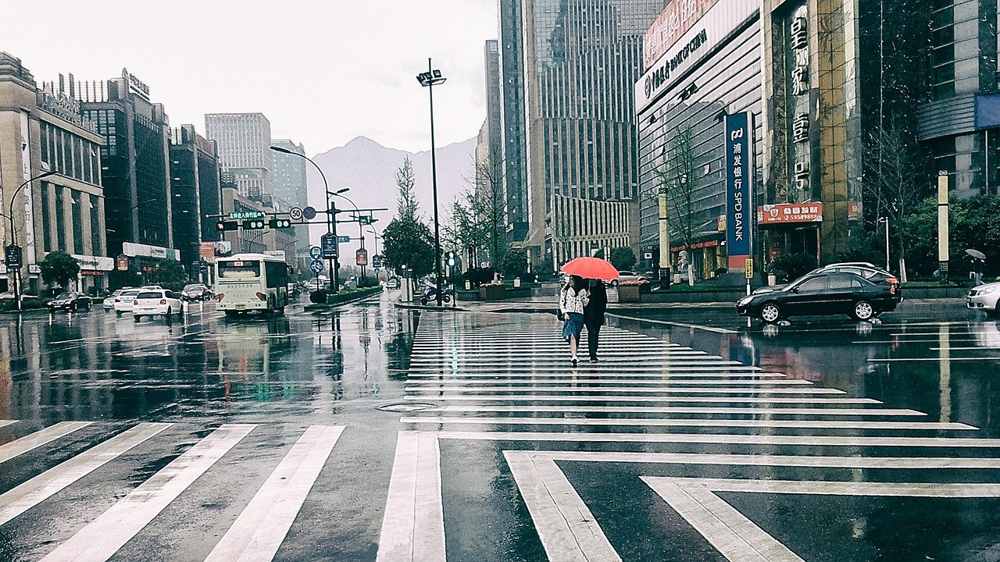
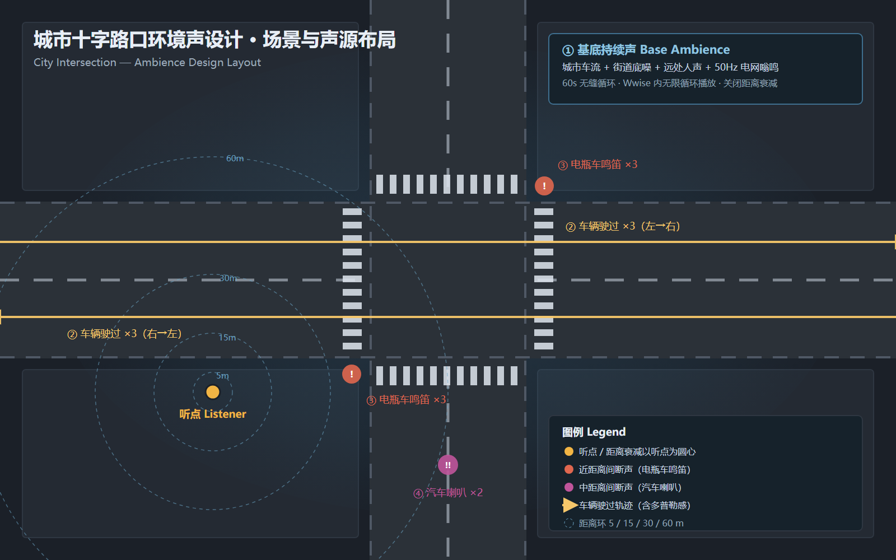

# 场景说明：小雨中的城市十字路口

## 一、场景描述

所选场景为**小雨中的城市主干道十字路口**，春秋季节的典型天气：阴天、光线平，雨不大但一直下，路面全湿并反光，行人撑伞过街，公交车与私家车在湿滑路面上减速通过。

路口的构成要素：四个方向的机动车道在中心交汇，四条斑马线环绕路口；信号灯、路灯与商铺灯箱构成稳定的 50 Hz 电网嗡鸣；雨点打在伞面、雨棚、路面上声音不同；轮胎压过积水有黏滞的"沙"声；行人踩到水洼会有短促的溅水。

> 示意图为配合本作业绘制的声源布局图，标出听点、距离环（5 / 15 / 30 / 60 m）与五类声源位置，用于说明设计意图，不是现场照片。

## 二、为什么选这个场景

1. **基底层与间断层的区分天然清晰**：雨、车流、底噪是几乎恒定的背景；喇叭、驶过、溅水是随机插入的事件，正好对应作业要求的"持续基底 + 间断随机"两类素材。
2. **距离层次丰富**：同一个路口同时有 3 米（身边踩水）、15 米（对向车道）、60 米（远处主干道）三个尺度的声源，便于验证 Wwise 的距离衰减是否真的起作用。
3. **雨声容易做砸**：雨是宽带噪声，做厚了会把 1–4 kHz 的车流、人声、喇叭一起盖住。这个场景要求同时保住两件事——听得出在下雨，其他声音还能分辨。

## 三、声源分析

| 层级 | 声源 | 特征 | 在场景中的作用 |
| --- | --- | --- | --- |
| 基底层 | 小雨 | 真实录音，能量集中在 1.2–10 kHz，30 秒周期循环 | 定天气 |
| 基底层 | 城市车流 | 合成的中频宽带噪声，密度随信号灯周期起伏 | 提供城市感 |
| 基底层 | 低频隆隆 | 布朗噪声经 130 / 55 Hz 低通 | 提供空间厚度 |
| 基底层 | 远处人声 | 1.6 kHz 带通噪声，不可辨识 | 提供拥挤感 |
| 基底层 | 电网嗡鸣 | 50 Hz 与 100 Hz | 信号灯、变压器的电气底噪 |
| 间断层 | 车辆驶过 | 4–5 秒，带通中心由远及近再远去，左右横穿 | 最频繁的事件声 |
| 间断层 | 电瓶车鸣笛 | 0.26–0.31 秒，峰频 3.8–4.8 kHz | 近距离、高频 |
| 间断层 | 汽车喇叭 | 0.33–0.66 秒，峰频 425–1005 Hz | 中距离 |
| 间断层 | 雨点打伞 | 3.2 秒，真实雨声打在伞面与雨棚上 | 把"雨"从小尺度拉近 |
| 间断层 | 踩水 | 0.8 秒，真实水花 | 强调地面是湿的 |

## 四、素材设计思路

素材来源分三类，全部可复现：

| 类型 | 素材 | 来源 |
| --- | --- | --- |
| 真实录音 | 基底雨声、雨点打伞 ×2、踩水 ×2 | Mixkit 免费音效库 |
| 真实录音派生 | 汽车喇叭 ×3、电瓶车鸣笛 ×3 | Mixkit 录音 + 变调 / 均衡 |
| 算法合成 | 城市层（车流 / 隆隆 / 人声）、车辆驶过 | `tools/gen_assets.mjs` |

作业允许"从各种现成的音效库素材包中搜索你需要的声音"，也允许"其他你能想到的办法或途径"。取舍原则：雨、喇叭这类质感难以用合成逼近的用真实录音；车流、驶过这类可以用物理模型描述的用合成，便于参数化调整。

### 基底是怎么拼的

真实雨声与城市层是两条独立素材，混音后导出：

1. **雨**：Mixkit "Light rain loop"（39.4 秒）。取前 33 秒，把末尾 3 秒与开头做等功率交叉淡化，得到 **30 秒无缝周期**，再平铺两次正好 60 秒——这样首尾和 30 秒处都没有接缝。原始录音偏暗（3.5–10 kHz 比中频低 6.5 dB，这是现场录音的常态），补 4.5 kHz +5 dB、8 kHz +3.5 dB，并削掉 320 Hz 的闷响。
2. **城市层**（合成，用 `--city-only-bed` 单独导出）：低频隆隆 + 车流 + 远处人声，只留三层。车流带通 850 Hz、Q 0.65，避免 300–600 Hz 的"风"感；各层 LFO 起伏压到 ±9%。
3. 混合比例：雨 −27 dBFS、城市层 −29.5 dBFS，成品归一化到 −28 dBFS RMS。城市层比雨低 2.5 dB，听感是"下雨的路口"，而不是"雨里有个路口"。

### 立体声结构

左右声道不是两套独立噪声（那样相关度为 0，展开后变负，折叠成单声道会互相抵消）。城市层用**共通主干 M + 独立侧信号 S**：L = M + 0.6S、R = M − 0.6S；150 Hz 以下强制居中。成品左右相关度 0.52、中侧比 −4.9 dB——有宽度，单声道不塌。

### 清晰度处理

30 Hz 高通去掉听不见却占电平的超低频；320 Hz 削 2.5 dB 去泥浆；2.2 kHz 削 1.5 dB 给事件声让位；15 kHz 低通去掉刺耳极高频。喇叭类另加 2.6 kHz 存在感。

### 其他声源

- **车辆驶过**（合成）：粉红噪声源以变速读取（接近 ×1.16、远离 ×0.84）模拟多普勒；带通中心按高斯曲线从 300 Hz 扫到 1800 Hz 再落回；叠加低频滚动与高频气流；等功率声像一侧穿到另一侧；加 41/77 ms 户外早期反射。
- **汽车喇叭**：Mixkit 真实录音三条（经典单音 / 双响 / 单响）。
- **电瓶车鸣笛**：在"小汽车喇叭"录音上变调 ×1.25 / ×1.42 / ×1.58，得到更短更尖的电子蜂鸣音色。
- **雨点打伞**：Mixkit "Rain splashing" 录音，补 5 kHz、裁到 3.2 秒；第二条整体上移 6% 并压暗，模拟更远的一把伞。
- **踩水**：Mixkit "Water splash" 录音，裁到 0.8 秒；第二条降速 10% 得到更闷的一脚。

## 五、规格与校验

全部素材：**48 kHz / 24 bit / stereo / .wav**，与作业要求一致。

| 文件 | 时长 | 峰值 | RMS |
| --- | --- | --- | --- |
| AMB_RainCityIntersection_Bed_Loop.wav | 60.00 s | −7.0 dBFS | −28.1 dBFS |
| SFX_CarPassby_01.wav | 4.60 s | −3.5 dBFS | −20.7 dBFS |
| SFX_CarPassby_02.wav | 5.40 s | −3.5 dBFS | −22.4 dBFS |
| SFX_CarPassby_03.wav | 4.00 s | −3.5 dBFS | −20.8 dBFS |
| SFX_EbikeHorn_01.wav | 0.31 s | −5.9 dBFS | −16.3 dBFS |
| SFX_EbikeHorn_02.wav | 0.28 s | −6.7 dBFS | −17.3 dBFS |
| SFX_EbikeHorn_03.wav | 0.26 s | −6.3 dBFS | −16.8 dBFS |
| SFX_CarHorn_01.wav | 0.33 s | −5.1 dBFS | −17.7 dBFS |
| SFX_CarHorn_02.wav | 0.66 s | −5.5 dBFS | −18.5 dBFS |
| SFX_CarHorn_03.wav | 0.55 s | −5.9 dBFS | −18.9 dBFS |
| SFX_RainOnCanopy_01.wav | 3.20 s | −8.5 dBFS | −31.1 dBFS |
| SFX_RainOnCanopy_02.wav | 3.20 s | −9.4 dBFS | −31.7 dBFS |
| SFX_PuddleStep_01.wav | 0.80 s | −5.9 dBFS | −26.3 dBFS |
| SFX_PuddleStep_02.wav | 0.80 s | −6.7 dBFS | −26.9 dBFS |

基底频谱分布（`tools/analyze.mjs` 实测，各频段相对电平）：25–60 Hz −73.1 dB、60–150 Hz −69.1、150–400 Hz −71.5、400–1200 Hz −66.4、1200–3500 Hz −66.9、3500–10000 Hz −67.9、10000–18000 Hz −75.6。1.2 k–10 kHz 是能量主体（雨的沙沙），400 Hz 以下整体低于中高频，所以听感是"下雨"而不是"低频隆隆"。

立体声指标：基底左右声道相关系数 **0.52**、中侧比 **−4.9 dB**（完全单声道为 1.0 / 侧声道为 −∞，两套独立噪声为 0.0）。事件声在 0.84–0.99 之间，保持点声源应有的居中感；雨点打伞是 0.25–0.28 的宽声场。相关系数为正意味着折叠成单声道时不会互相抵消。

自检项（`node tools/analyze.mjs` 可复现）：直流偏移 < 1e-7；基底循环接缝无跳变；所有事件声尾部静音已裁除。

## 六、素材来源与许可

### 场景图片
- **场景照片**：Pixabay，Pixabay Content License（可免费使用、无需署名）
  <https://cdn.pixabay.com/photo/2015/04/05/07/28/street-707446_1280.jpg>
- **声源布局示意图**：本人绘制。

### 真实录音（Mixkit 免费音效库，Mixkit License：免费商用、无需署名）

| 导出文件 | Mixkit 原始条目 | 处理 |
| --- | --- | --- |
| AMB_RainCityIntersection_Bed_Loop | Light rain loop（#1253） | 30 s 无缝周期 ×2、+4.5k/+8k 补偿、与城市层混音、归一至 −28 dBFS |
| SFX_RainOnCanopy_01 | Rain splashing（#1264） | 裁到 3.2 s、220 Hz 高通、5 kHz +3 dB |
| SFX_RainOnCanopy_02 | Rain splashing（#1264） | 变调 ×1.06、240 Hz 高通、压暗（模拟更远的一把伞） |
| SFX_PuddleStep_01 | Water splash（#1311） | 裁到 0.8 s、80 Hz 高通 |
| SFX_PuddleStep_02 | Water splash（#1311） | 变调 ×0.90、70 Hz 高通 |
| SFX_CarHorn_01 | Classic car horn（#1565） | 裁静音、90 Hz 高通、320 Hz −2 dB |
| SFX_CarHorn_02 | Car double horn（#719） | 同上 |
| SFX_CarHorn_03 | Car horn（#718） | 同上 |
| SFX_EbikeHorn_01 | Small car horn（#717） | 变调 ×1.25、240 Hz 高通 |
| SFX_EbikeHorn_02 | Small car horn（#717） | 变调 ×1.42、280 Hz 高通 |
| SFX_EbikeHorn_03 | Small car horn（#717） | 变调 ×1.58、320 Hz 高通 |

两处变调的动机：国内电瓶车喇叭是短促的电子蜂鸣，音高比汽车喇叭高一个八度左右，在真实录音上做速率/音高变换比重新合成更自然；雨点打伞的第二条同理，用同一素材变调+压暗做出更远的一把伞，而不是再找一条录音。

所有下载、裁剪、变调、EQ、48k24 导出都已脚本化：`tools/import_library_sfx.mjs`（喇叭与雨声事件）、`tools/build_rain_bed.mjs`（基底），可直接重跑。

### 算法合成（本人编写）

- 基底中的**城市层**：低频隆隆、车流、远处人声；
- **车辆驶过** ×3。

生成脚本 `tools/gen_assets.mjs`（`--city-only-bed` 可单独导出城市层）。
